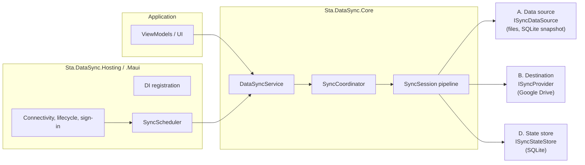
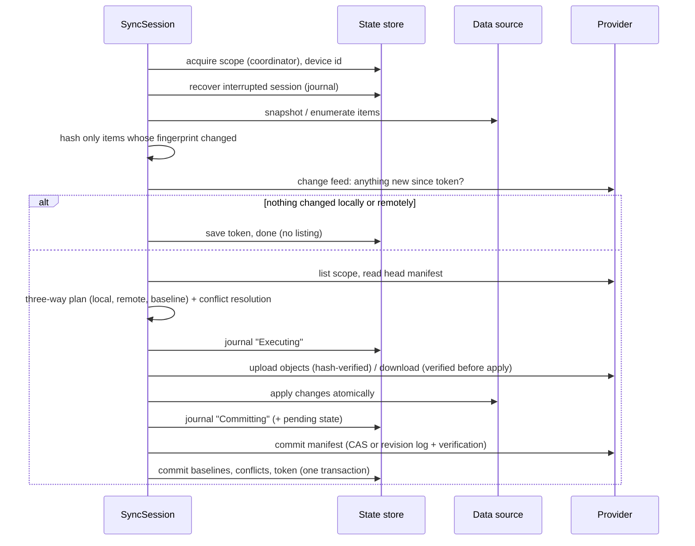
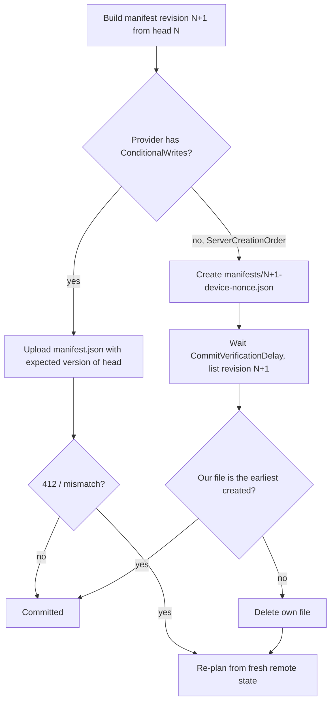

# Architecture

## Four separate concerns



| Concern | Contract | Version 1 implementation | Knows about |
|---|---|---|---|
| A. What is synchronized | `ISyncDataSource` (+ `ISyncSnapshotSource`, `ISyncChangeTracking`) | `FileSyncSource`, `SqliteSnapshotSyncSource` | local storage only |
| B. Where it is stored | `ISyncProvider` (+ `IRemoteChangeFeed`, `SyncProviderCapabilities`) | `GoogleDriveSyncProvider` | its API only |
| C. Engine | `IDataSyncService` | `DataSyncService`, `SyncSession` | abstractions only |
| D. Metadata | `ISyncStateStore` | `SqliteSyncStateStore` | its database only |

Providers are a dumb blob store addressed by logical paths. Everything that makes synchronization correct
(manifests, versions, baselines, conflict detection, verification, recovery) lives once in the engine, so a new
destination cannot get it wrong.

## Remote layout

```
{RootFolder}/{ApplicationId}/{ScopeId}/manifest.json                       providers with conditional writes
{RootFolder}/{ApplicationId}/{ScopeId}/manifests/{rev:12}-{device}-{nonce}.json   revision log (e.g. Google Drive)
{RootFolder}/{ApplicationId}/{ScopeId}/objects/{sha256}[.{transform}]       immutable, content-addressed content
```

Example: `Sta.DataSync/DartTA/settings/objects/9f86d0…`. Content objects are immutable and named by their SHA-256,
so identical content is stored once, an upload never modifies data another device may be reading, and a crash between
upload and commit only leaves unreferenced objects (removed by cleanup after a grace period).

The **manifest** (schema version 1) lists every item of a scope:

```json
{
  "schemaVersion": 1, "revision": 42, "parent": "…/manifests/000000000041-a1b2-….json",
  "commitId": "5f0c…", "deviceId": "a1b2c3d4", "createdUtc": "2026-11-11T10:00:00Z",
  "items": [ { "id": "settings.json", "version": 4, "hash": "sha256:…", "size": 2048, "deleted": false,
               "modifiedUtc": "…", "modifiedBy": "a1b2c3d4", "object": "…" } ]
}
```

Unknown properties are preserved on round trips (forward compatibility); a manifest with a higher schema version is
refused, never overwritten. Tombstones (`deleted: true`) record deletions and are kept for `TombstoneRetention`.

## Synchronization pipeline



1. **Coordination.** `SyncCoordinator` serializes runs per scope (independent scopes run in parallel). While a run
   is active at most one more is queued; later callers share it.
2. **Local detection.** Snapshot sources provide a consistent view for the whole session. Items are hashed only when
   their fingerprint (length + modification ticks, or WAL state for SQLite) differs from the one stored with the cached
   hash. Timestamps never decide what changed.
3. **Remote detection.** With a change feed (Google Drive change tokens), an unchanged scope costs one API call. The
   token stored after a run is the one taken *before* reading remote state, so concurrent changes are never missed.
4. **Planning** (`SyncPlanner`, pure and deterministic). Per item: local value, remote value and baseline (last common
   hash or deletion). A side changed when its value differs from the baseline. Both changed to different values →
   conflict; both to the same value → adopt. Deletion evidence: a local deletion needs a baseline, a remote deletion
   needs a tombstone. A remote item that is simply missing is re-uploaded (repair), never deleted.
5. **Conflict resolution** turns conflicts into operations or leaves them open (see below).
6. **Validation.** Scopes are checked at startup (provider must offer safe commits, writable source for download
   modes, resolver for `Custom`); operations are checked against source capabilities.
7. **Execution.** Bounded parallelism (`MaxParallelTransfers`), groups of dependent operations run in order and stop at
   the first failure. Uploads stream through a hashing wrapper; if the content no longer matches the planned hash the
   object is deleted and the item stays pending. Downloads reach the source through a verifying stream; sources write
   to a temporary file and replace only after the hash and their own version check (`ExpectedCurrentFingerprint`) passed.
8. **Commit.** Remote first (manifest), then local state in one transaction. Metadata is written only for operations
   that succeeded.

## Concurrency protocol



- Google Drive v3 cannot update a file conditionally, so it uses the **revision log**: every commit creates a new file;
  among files of the same revision the one the server created first wins, and every device evaluates the same rule.
  A writer treats its commit as successful only after it observed itself as the winner.
- Remaining risk: if Drive's listing were not yet consistent at verification time, two devices could both believe they
  won. The loser detects this on its next run (its revision file is not the winner) and restores the baselines it had
  before that commit (`OwnCommitRollback`), so its changes are planned again — as uploads or as conflicts, never lost.
- Providers with neither capability are refused for upload modes (`SyncConfigurationException`).

## Conflicts

| Strategy | Behavior |
|---|---|
| `KeepBoth` (default) | Remote version kept as `name (conflict <date> <device>).ext`, local version uploaded under the original id; the copy is written before the original is replaced. Needs `SyncDataSourceCapabilities.CreateItems`; otherwise the conflict stays open. |
| `KeepLocal` / `KeepRemote` | The chosen side wins; only possible when the mode allows that direction. |
| `LatestWins` | Newer modification time wins; equal or unknown times fall back to `KeepBoth`. Only use with trustworthy clocks. |
| `Manual` | Nothing changes; the conflict is stored and returned until `ResolveConflictAsync`. |
| `Custom` | Registered `IConflictResolver` decides. |

A stored decision is applied only while both versions still have the hashes it was made for.

## Crash recovery

The journal (`ISyncStateStore`) records each session's phase before the step it describes:

| Phase at restart | Recovery |
|---|---|
| `Executing` | Local writes are atomic and no metadata was committed. The entry is dropped; the next comparison sees equal content on both sides and adopts it without transfers. |
| `Committing` | The pending state is stored in the entry. If the written manifest is the accepted revision, the state is committed; otherwise the orphan is deleted and the changes are planned again. |

## Design decisions and tradeoffs

| Decision | Why | Cost |
|---|---|---|
| Content-addressed objects + manifest instead of mirroring files | Atomic multi-item commits, deduplication, safe concurrent readers, provider stays trivial | Remote files are not human-readable by name |
| Revision log for Google Drive | Drive v3 has no compare-and-swap | One file per commit; old revisions cleaned up after `KeepManifestRevisions` and a grace period |
| Three-way comparison with stored baselines | Detects independent edits without trusting clocks | State store must be kept; losing it degrades to "first sync" semantics (safe, may report conflicts) |
| SQLite snapshots via the backup API | Consistent copies of live WAL databases; restores do not corrupt open connections | Whole-database granularity in version 1 |
| Separate state database | Never mixes sync metadata into application data | One more file per installation |
| Foreground scheduler | Android/iOS cannot guarantee background services | Synchronization pauses in the background (configurable) |
